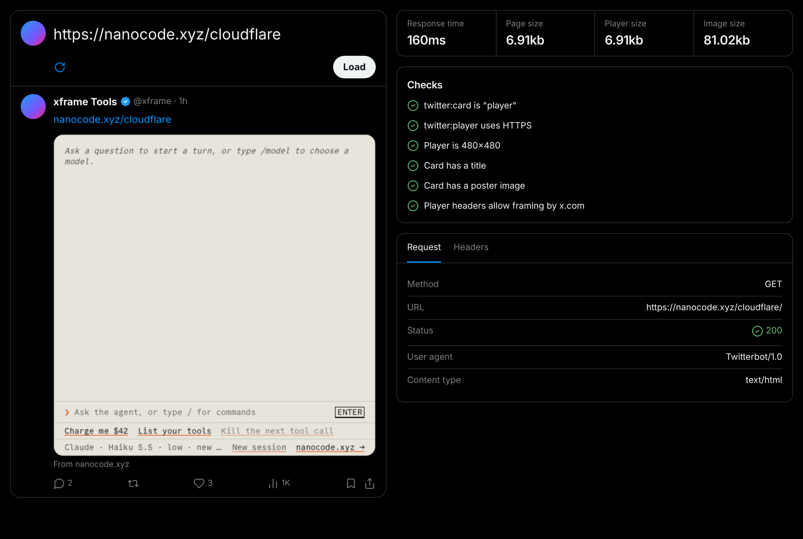

# xframe Tools

Build X player cards under the same sandbox, permissions, and headers that X applies.



## Getting Started

### 1. Install

```sh
npm i -D xframe-tools
```

### 2. Set Up

#### Vite

Add the plugin to the player app's Vite config. The dev server then serves the devtools beside the app.

```ts
import { defineConfig } from 'vite'
import { xframe } from 'xframe-tools/vite'

export default defineConfig({
  plugins: [xframe()],
})
```

#### Cloudflare Worker

Route `/__xframe` requests to the devtools in an existing Worker, or deploy a Worker that serves only the devtools.

```ts
import { Devtools } from 'xframe-tools/worker'

const devtools = Devtools.create()

export default {
  fetch(request, env, ctx) {
    if (Devtools.matches(request)) return devtools.fetch(request, env, ctx)
    return app.fetch(request, env, ctx)
  },
}
```

### 3. Open the Devtools

Open `/__xframe` on the dev server or the Worker, such as `http://localhost:5173/__xframe`. Paste a page URL or a player URL into the composer, or pass it in the query string:

```
http://localhost:5173/__xframe/?url=https://nanocode.xyz/cloudflare
```

The player must be cross-site from the devtools page, as it is from `x.com`. When the devtools and the player share a loopback host, the page links to the other one, such as `127.0.0.1` for `localhost`.

## Development

```sh
pnpm i                # install dependencies (Node 24.21 or later)
pnpm dev              # serve the devtools at http://localhost:3000/__xframe/
pnpm test             # run the integration suite in Chromium
pnpm check            # format and lint
pnpm check:types      # type-check
pnpm check:policy     # compare the captured policy with X's live cards-frame
pnpm update:policy    # capture X's live cards-frame policy again
pnpm build            # build the package: the app into dist/app, and the entries into dist/lib
pnpm changeset        # describe a change for the next release
pnpm deploy           # deploy with void deploy
```

Pushes to `main` open a version pull request with Changesets. When it merges, the release workflow publishes `xframe-tools` to npm.

`node test/fixtures/Player.ts` serves a probe player at `http://127.0.0.1:5173`. It reports which capabilities the sandbox allows, and it opens a popup with a form.
