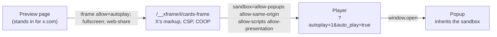

# xframe Tools

Build X player cards under the same sandbox, permissions, and headers that X applies.

## Overview

X renders a `twitter:player` card in two nested iframes. The timeline frames `x.com/i/cards-frame/<postId>`, and that document frames the player with a sandbox. The player and every popup it opens inherit that sandbox.

The devtools serve the same two layers. The cards-frame markup and headers are captured from X and served verbatim, so a player that works here works on X.



## What X Enforces

| Restriction                                  | Effect on a player                                                                         |
| -------------------------------------------- | ------------------------------------------------------------------------------------------ |
| No `allow-forms`                             | Form submission is blocked, in the player and in its popups                                |
| No `allow-popups-to-escape-sandbox`          | Popups inherit the full sandbox                                                            |
| No `allow-modals`                            | `alert`, `confirm`, and `prompt` return at once                                            |
| No `allow-top-navigation`, `allow-downloads` | The player cannot navigate the timeline or download files                                  |
| `allow` is `autoplay; fullscreen; web-share` | Passkeys, clipboard writes, camera, and other permission-gated APIs fail                   |
| Cross-site from `x.com`                      | Storage and cookies are partitioned from the player's own top-level site                   |
| Card rules                                   | No player without a title, `twitter:player`, and width and height. HTTPS only. At most 1:1 |

## Usage

Open the devtools, then paste a page URL or a player URL. The URL also loads from the query string:

```
http://localhost:3000/__xframe/?url=https://nanocode.xyz/cloudflare
```

The server reads the page's card tags with X's crawler user agent, `Twitterbot/1.0`, and fetches the player document and poster image. The post renders on the left. The inspector on the right shows:

- **Metrics:** response time, and the sizes of the page, the player document, and the poster image.
- **Checks:** what X would render, including whether the player's `X-Frame-Options` or `frame-ancestors` lets x.com frame it.
- **Frame policy:** the sandbox tokens that X grants and blocks, and the frame's `allow` list.
- **Network:** request and headers tabs, with the status, redirects, user agent, and the player's response headers that affect framing.

### Local Players

A loopback URL, such as `http://localhost:5173`, loads too. X frames only HTTPS players, so a local player needs two relaxations of X's CSP: loopback `frame-src` sources, and no `upgrade-insecure-requests`. The checks and the `x-xframe-deviations` header report both.

Serve the devtools and the player on different loopback hosts, such as `localhost` and `127.0.0.1`. Same-site framing hides storage partitioning, so the page reports it and links to the other host.

## Development

```sh
pnpm i                # install dependencies (Node 24.21 or later)
pnpm dev              # serve the devtools at http://localhost:3000/__xframe/
pnpm test             # run the integration suite in Chromium
pnpm check            # format and lint
pnpm check:types      # type-check
pnpm check:policy     # compare the captured policy with X's live cards-frame
pnpm update:policy    # capture X's live cards-frame policy again
pnpm build            # build the Worker with Void
pnpm deploy           # deploy with void deploy
```

`node test/fixtures/Player.ts` serves a probe player at `http://127.0.0.1:5173`. It reports which capabilities the sandbox allows, and it opens a popup with a form.
